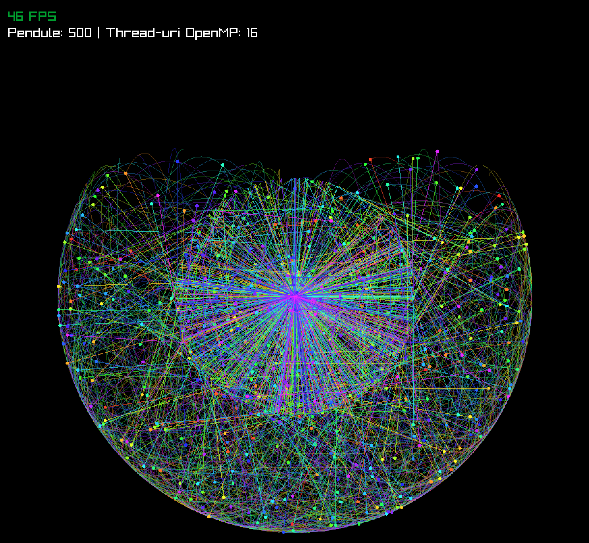
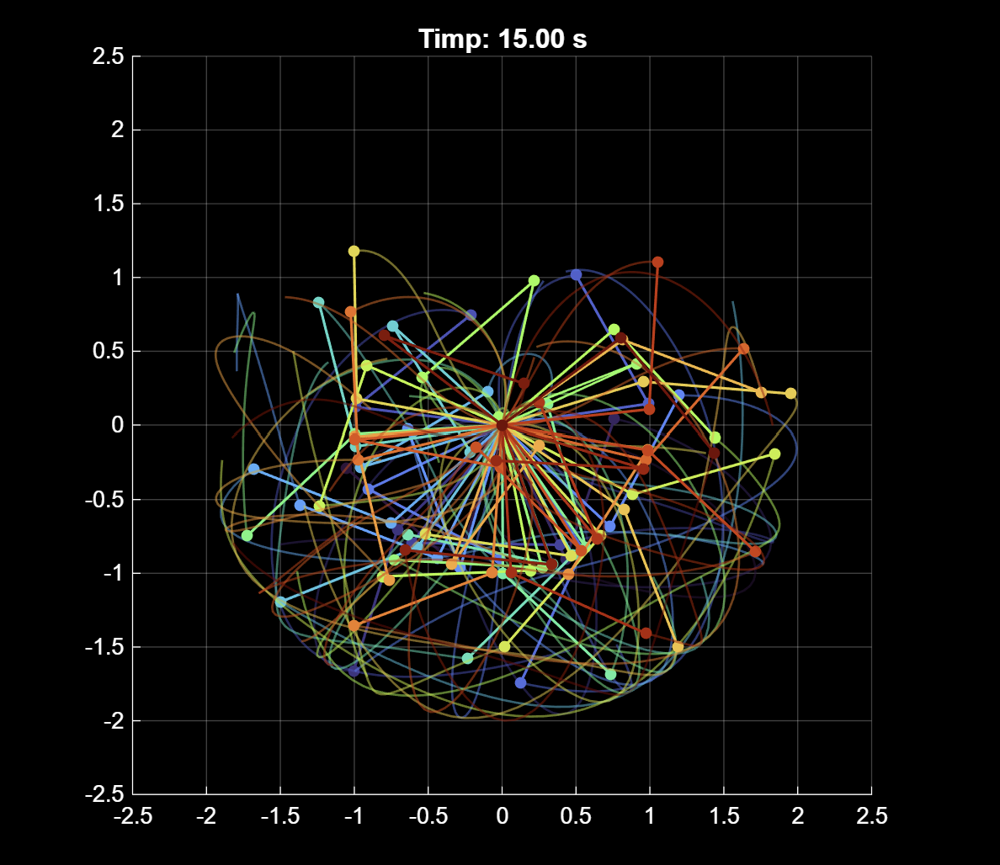

# Butterfly Effect - Double Pendulum Simulation - MATLAB, C++ & OpenMP

Hello! I implemented a physical and visual simulation of a chaotic system consisting of 500 double pendulums. The project is divided into four main steps: mathematical modeling using the Lagrange equations, numerical integration using the 4th-order Runge-Kutta method, visualizing using the Butterfly Effect, and CPU parallelization using OpenMP alongside 2D rendering with Raylib. I first implemented the mathematical model and the integration logic in MATLAB, then ported them to C++ to run the larger simulation across multiple CPU cores.

## Demo

### C++ with OpenMP and Raylib



### MATLAB prototype



## Compilation

### With Makefile

To compile the project using the Makefile on Linux or WSL, run `make` in the terminal. To compile and immediately start the simulation window, run `make run`. To remove the compiled executable, run `make clean`.

### Without Makefile - manual
Once Raylib and the C++ compiler are installed on your Linux or WSL system, you can compile and run the project manually from the terminal:

```bash
g++ main.cpp -o pendul -O3 -fopenmp -lraylib -lGL -lm -lpthread -ldl -lrt -lX11
./pendul
```

## Required Dependencies

To compile and run the C++ version, you need `g++` with OpenMP support and Raylib installed for desktop OpenGL. The Makefile also requires `make`. On WSL, graphical support is needed to display the simulation window. The [Raylib Linux guide](https://github.com/raysan5/raylib/wiki/Working-on-GNU-Linux) explains how to install the library and its dependencies. The original prototype runs in MATLAB.

## Structures Used

Each pendulum has a four-component state containing its two angles and two angular velocities. In the C++ version, the state is stored in an array, while the screen positions, color and recent trajectory belong to the same pendulum object.

```cpp
// State: [theta1, theta2, omega1, omega2]
using State = std::array<double, 4>;

struct Pendul {
    State x;                    // Current angles and angular velocities!
    Vector2 p1, p2;             // Positions of the two masses on screen!
    std::deque<Vector2> urma;   // Recent positions of the second mass!
    Color culoare;              // Color assigned to this pendulum!
};
```

## Step 1 -- Mathematical modeling and the Lagrange's equations

For the first step, I worked out the equations of motion and implemented them in MATLAB as the function `f_pendul(t, x)`. The state is $x = [\theta_1, \theta_2, \omega_1, \omega_2]^T$, where the angles are measured from the downward vertical direction. The positions of the two masses are $x_1 = L_1\sin\theta_1$, $y_1 = -L_1\cos\theta_1$, $x_2 = x_1 + L_2\sin\theta_2$ and $y_2 = y_1 - L_2\cos\theta_2$. From these positions, we obtain the velocities and write the kinetic energy $T$ and gravitational potential energy $V$. We then construct the Lagrangian $\mathcal{L} = T - V$ and apply the Lagrange's equations to obtain the angular accelerations. Together with $\dot\theta_1 = \omega_1$ and $\dot\theta_2 = \omega_2$, this gives a first-order system with four state variables. In the MATLAB prototype, I used $g = 9.81$, $m_1 = m_2 = 1$ and $L_1 = L_2 = 1$. This was the mathematical model that I later transferred to C++.

## Step 2 -- Numerical integration with 4th-order Runge-Kutta (RK4)

For the second step, I first implemented the RK4 algorithm in MATLAB to calculate the evolution of each pendulum. The prototype uses a constant step $h = 0.01$ over 15 seconds of simulation time. At each iteration, we calculate four intermediate derivatives and combine them to obtain the next state:

```matlab
k1 = f_pendul(tn, xn);
k2 = f_pendul(tn + h/2, xn + h*k1/2);
k3 = f_pendul(tn + h/2, xn + h*k2/2);
k4 = f_pendul(tn + h, xn + h*k3);
x_rk4(:, k+1) = xn + (h/6)*(k1 + 2*k2 + 2*k3 + k4);
```

The MATLAB version computes the trajectories before displaying the animation. After testing the model and the integration logic there, I ported the same calculations to C++, where the states are updated while the simulation is running. The C++ version uses $h = 0.005$ and three RK4 substeps per rendered frame. Moving this part to C++ also made it possible to parallelize the independent pendulum updates with OpenMP.

## Step 3 -- Demonstrating the Butterfly Effect and storing the trails

For the third step, I started the MATLAB prototype with 50 double pendulums. The first pendulum has the initial state $[2\pi/3, 2\pi/3, 0, 0]^T$, and each consecutive pendulum receives an additional $10^{-4}$ radians on its second angle. The C++ version increases the number of pendulums to 500 and uses a smaller difference of $10^{-5}$ radians between consecutive second angles. At first, the pendulums move almost together, but the differences between their trajectories become visible as the simulation evolves. This illustrates the sensitivity to initial conditions associated with the Butterfly Effect. In MATLAB, I store the calculated coordinates in the matrices `X1`, `Y1`, `X2` and `Y2`. In C++, each pendulum stores its recent trail in a `std::deque<Vector2>`: new positions are added at the back, and the oldest ones are removed when the trail exceeds 60 points. This keeps the trail length and its memory requirements bounded.

## Step 4 -- Parallelization with OpenMP and rendering with Raylib

For the final step, I moved from the MATLAB prototype to the C++ simulation with 500 pendulums. I used OpenMP to distribute the physics calculations across multiple CPU cores, rather than doing all the updates on a single core. The pendulums do not interact with each other, so each loop iteration can update the state and coordinates of a different pendulum independently. The physics loop uses `#pragma omp parallel for schedule(static)` to divide these updates among the available CPU threads. Once the updates are complete, the main thread draws the pendulum arms and their colored trails using Raylib. This separates the parallel numerical calculations from rendering and allows the larger simulation to be displayed interactively.

This was my project! Thank you for your attention!
